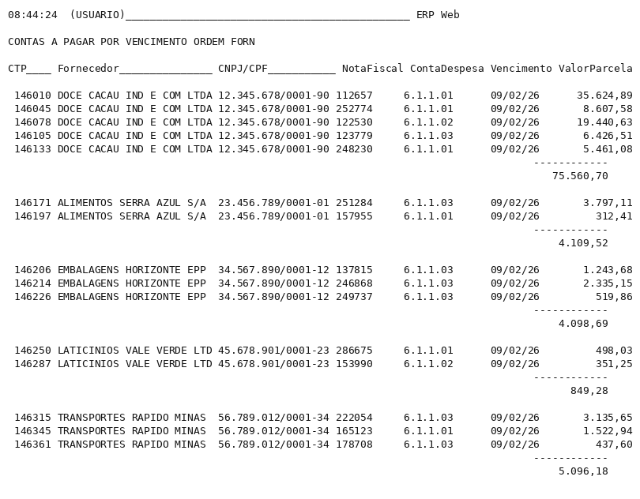
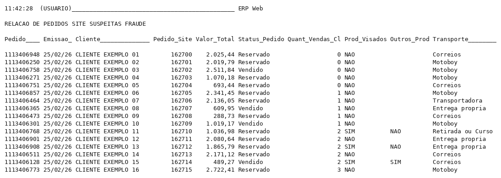
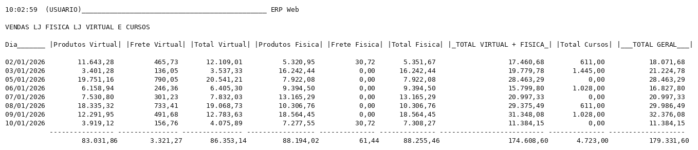

# 🗄️ Portfólio MySQL, Relatórios para ERP

> Relatórios SQL desenvolvidos em MySQL para um ambiente real de ERP no varejo (loja física, e-commerce e cursos). As consultas extraem, consolidam e analisam dados para apoiar decisões financeiras, fiscais, de compras, de estoque e de vendas, e são usadas no dia a dia pela gestão.

[](https://www.mysql.com)
[](https://pt.wikipedia.org/wiki/SQL)
[](#)

---

## 🎯 Sobre o projeto

Em uma operação de varejo o ERP guarda tudo, mas os relatórios padrão raramente respondem às perguntas que a gestão faz. Este repositório reúne consultas que escrevi para responder a essas perguntas direto no banco do ERP, como "quais produtos deste fornecedor ficaram mais caros desde o ano passado", "quanto vence na semana que vem por fornecedor" ou "quais pedidos do site têm cara de chargeback".

Cada arquivo `.sql` traz um cabeçalho com descrição, objetivo, regras de negócio, parâmetros e colunas de saída, e um `.png` ao lado com um exemplo do resultado.

> ℹ️ Os prints de exemplo foram gerados com **dados fictícios** (fornecedores, clientes, produtos e valores inventados), preservando apenas o formato do relatório. As consultas são as mesmas usadas em produção.

---

## 📊 Relatórios

### 💰 Financeiro
| Relatório | O que responde |
|---|---|
| [Contas a pagar por competência](financeiro/contas_a_pagar_por_competencia.sql) | Quanto foi gasto em cada mês de competência, por fornecedor e conta de despesa |
| [Contas a pagar por vencimento e fornecedor](financeiro/contas_a_pagar_por_vencimento_e_fornecedor.sql) | O que vence em um período, agrupado por fornecedor, para o fluxo de caixa |

### 🛒 Compras
| Relatório | O que responde |
|---|---|
| [Comparação de preço de compra por fornecedor](compras/comparacao_preco_compra_por_fornecedor.sql) | Quais produtos de um fornecedor ficaram mais caros ou mais baratos entre dois períodos |
| [Comparação de gastos com fornecedores por período](compras/comparacao_gastos_fornecedores_por_periodo.sql) | Como o total comprado de cada fornecedor variou entre dois períodos |

### 📦 Estoque
| Relatório | O que responde |
|---|---|
| [Peso do estoque atual por fornecedor](estoque/peso_estoque_atual_por_fornecedor.sql) | Quantos quilos de produto de um fornecedor existem em estoque |
| [Saldo de estoque por mês/ano e fornecedor](estoque/saldo_estoque_por_mes_ano_e_fornecedor.sql) | Saldo de cada produto de um fornecedor em um mês de referência |

### 🛍️ Vendas
| Relatório | O que responde |
|---|---|
| [Vendas do e-commerce por cidade com percentual](vendas/vendas_ecommerce_por_cidade_com_percentual.sql) | De onde vêm as vendas da loja virtual e o peso de cada cidade |
| [Pedidos do site com suspeita de fraude](vendas/pedidos_site_suspeita_fraude.sql) | Quais pedidos têm perfil de chargeback, para barrar antes da expedição |
| [Vendas por canal: loja física, virtual e cursos](vendas/vendas_por_canal_fisica_virtual_e_cursos.sql) | Faturamento diário por canal, com produtos, frete e total |
| [Vendas por fornecedor com estoque e referência](vendas/vendas_por_fornecedor_com_estoque_e_referencia.sql) | Quanto vendeu de cada produto de um fornecedor e quanto ainda há em estoque |

### 🧾 Fiscal
| Relatório | O que responde |
|---|---|
| [Notas com base de ICMS para PIS/COFINS](fiscal/notas_base_icms_para_pis_cofins.sql) | Base de cálculo de PIS/COFINS das notas de entrada, por CFOP |

---

## ✨ O que as consultas demonstram

- Junções entre várias tabelas (títulos, parcelas, notas, itens, produtos, fornecedores, clientes)
- Subconsultas e agregações por período, com comparação entre dois intervalos
- Regras fiscais e de conciliação aplicadas no SQL (CFOP, flags em campos de bits, base de ICMS)
- Filtros parametrizados (loja, fornecedor, período, canal, CFOP), com valores opcionais
- Linha de total geral com `UNION ALL` e participação percentual
- Agrupamento dinâmico (por loja ou por produto) controlado por parâmetro
- Regras de negócio documentadas no cabeçalho de cada consulta

---

## ⚙️ Formato dos parâmetros

As consultas rodam no módulo de relatórios do ERP, que lê os parâmetros declarados no bloco `%vars` e substitui as referências `[$parametro]` em tempo de execução. Para rodar fora do ERP, basta trocar as referências por valores literais.

```sql
%vars
$datai = {:d:Data inicial}
$dataf = {:d:Data final}
%
SELECT ... WHERE inv.date BETWEEN [$datai] AND [$dataf]
```

---

## 📁 Estrutura

```
├── financeiro/   Contas a pagar por competência e por vencimento
├── compras/      Comparações de preço e de gasto por fornecedor
├── estoque/      Peso e saldo de estoque por fornecedor
├── vendas/       Vendas por cidade, por canal, por fornecedor e pedidos suspeitos de fraude
└── fiscal/       Base de ICMS para PIS/COFINS
```

Cada relatório tem um `.sql` (consulta comentada) e um `.png` (exemplo de saída com dados fictícios).

---

## 📸 Exemplos de saída

### Contas a pagar por vencimento e fornecedor


### Pedidos do site com suspeita de fraude


### Vendas por canal


---
> ⚖️ **Uso do código:** Este repositório é disponibilizado apenas para fins de portfólio e avaliação profissional. Todos os direitos reservados. Não é permitido copiar, modificar, distribuir ou usar o código, no todo ou em parte, para qualquer finalidade, sem autorização por escrito.
---

## 👤 Autor

**Heberth Augusto**

[](https://www.linkedin.com/in/heberth-augusto-ti/)
[](https://github.com/heberthaugusto)

*Consultas desenvolvidas com IA generativa (Claude) como ferramenta de trabalho, com revisão da lógica e validação dos resultados em homologação antes do uso em produção.*
